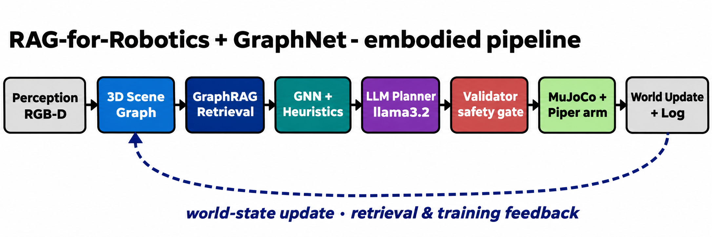
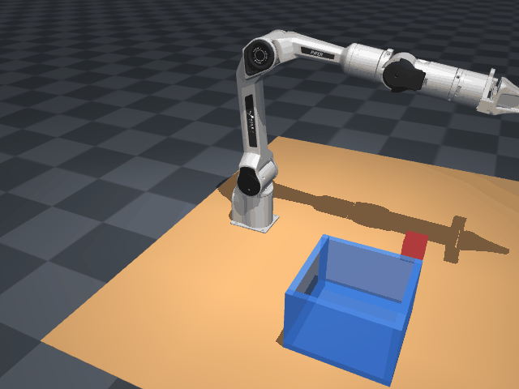
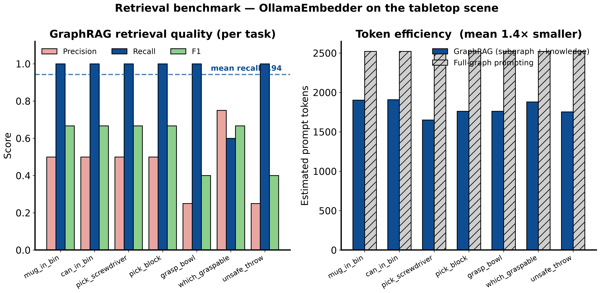
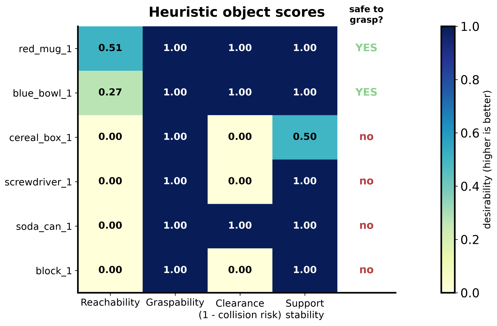

<div align="center">

# 🤖 RAG-for-Robotics + GraphNet

**An embodied robot assistant that retrieves what matters, reasons over it, and acts — safely.**

It turns a natural-language instruction into a **validated** robot action plan by retrieving the task-relevant slice of a live 3D scene graph (GraphRAG), scoring it with graph reasoning, planning with an LLM, and **gating every plan through a deterministic safety validator** before a real simulated arm executes it.



`research-backed` · `simulation-first` · `safety-gated` · `84 tests` · `100% local`

</div>

---

## 🎬 See it run

A live **llama 3.2** plan → deterministic validator → **real AgileX Piper arm** (MuJoCo + IK) places the mug in the bin:

<div align="center">



</div>

> The LLM proposes; it never executes. Nothing moves unless the validator passes — a fabricated object id, an out-of-reach target, or a bad step order is **blocked**, and the world is left untouched.

---

## ✨ What it does

| | |
|---|---|
| 🧠 **GraphRAG, not prompt-stuffing** | Retrieves the minimal task-relevant **subgraph + knowledge**, never the whole scene — grounded in [EmbodiedRAG](https://arxiv.org/abs/2410.23968) & [G-Retriever](https://arxiv.org/pdf/2402.07630) |
| 📊 **Graph reasoning** | Heuristic scorers (reachability, graspability, collision, support) + a **PyTorch Geometric** tensor layer ready for a GNN |
| 📝 **Strict, grounded plans** | LLM emits a schema-checked `ActionPlan`; ids are grounded against the scene; repair loop + `ask_human` fallback |
| 🛡️ **Deterministic safety gate** | Reachability, collision, payload, gripper-fit, fragile-handling, human-proximity, action-sequence — the LLM is **never** the safety authority |
| 🦾 **Real physics execution** | MuJoCo with the real **AgileX Piper** 6-DoF arm driven by inverse kinematics; world-state updated from sensor read-back |
| 🔒 **Fully local & auditable** | Local Ollama (LLM + embeddings), every retrieved fact carries provenance, every episode logged end-to-end |

---

## 📈 Results (measured, not claimed)

Every number below is produced by the code (`figures/make_figures.py`) — the project's rule is *never invent benchmark results*.

### Retrieval is high-recall and token-efficient


- **Mean recall 0.94** across the task suite — the retriever rarely misses a task-relevant entity (recall-first by design; the validator prunes the rest).
- **~1.4× fewer prompt tokens** than full-graph prompting on a 10-node scene — the gap grows with scene size (EmbodiedRAG's scalability argument).

### Heuristic scores are explainable and gate grasping


- Each object gets transparent, auditable scores; only reachable + graspable + low-collision objects are marked **safe to grasp**.
- The box that *supports a stack* is correctly flagged (clearance 0, stability 0.5) and rejected.

---

## 🚀 Quickstart

```bash
# Phase 3+ uses a Python 3.12 venv (see risk R-01)
py -3.12 -m venv .venv
./.venv/Scripts/python -m pip install -e . pytest ollama chromadb mujoco imageio matplotlib

./.venv/Scripts/python -m pytest -q                      # 84 tests
./.venv/Scripts/python examples/arm_full_loop_demo.py    # LLM → validate → real arm
```
The LLM + embeddings run on local **Ollama** (`ollama serve` + `llama3.2`, `nomic-embed-text`). Every demo falls back to an offline path if Ollama isn't running, so the test suite is fully hermetic.

### Demos
| Command | Shows |
|---|---|
| `examples/arm_full_loop_demo.py` | full loop on the **real Piper arm** → `runs/arm_full_loop.mp4` |
| `examples/arm_pick_place_demo.py` | arm pick-and-place, standalone → `runs/arm_execution.mp4` |
| `examples/custom_scene_graph_demo.py` | build your **own** scene graph and run it |
| `examples/graphrag_demo.py` | two-stage retrieval + benchmark table |
| `examples/scoring_demo.py` | heuristic scores + PyG `HeteroData` tensors |
| `examples/scene_vocabulary.py` | what kinds / materials / affordances are recognized |
| `figures/make_figures.py` | regenerate the figures above from live data |

---

## 🧭 How it works

```
instruction
   └─▶ 3D scene graph (NetworkX, heterogeneous)
        └─▶ GraphRAG: semantic entity match → induced-subgraph expansion (+ provenance)
             └─▶ scoring: reachability / graspability / collision / support
                  └─▶ LLM planner (llama3.2) → strict ActionPlan JSON
                       └─▶ ✅ deterministic validator + safety guard   ← nothing executes unless this passes
                            └─▶ MuJoCo + Piper arm (IK)  →  world-state update  →  episode log
```

Static knowledge (safety rules, grasp procedures, task templates) and the live scene live in **one heterogeneous graph**, so retrieval traverses both.

---

## 🗺️ Status

| Phase | State |
|-------|-------|
| 1 — Research & requirements | ✅ |
| 2 — Dynamic 3D scene graph | ✅ |
| 3 — GraphRAG retrieval | ✅ |
| 4 — Heuristic scoring + GNN tensor schema | ✅ |
| 5 — LLM planner (strict JSON) | ✅ |
| 6 — Safety validator + MuJoCo + real arm | ✅ |

**Honest labels** (a core principle):
- **Implemented & tested:** everything above — 84 tests.
- **Mocked:** perception (ground-truth poses stand in for a detector).
- **Documented abstraction:** the grasp *bond* is kinematic; the **arm is full physics + IK** (straight-down grasps exceed the small arm's dexterous workspace). Contact grasping is the next upgrade.
- **Deferred:** GNN *training* — heuristics ship first; a GNN is adopted only if it beats them on labeled sim data.

---

## 🛠️ Stack & key decisions
GNN: **PyTorch Geometric** · Simulator: **MuJoCo** + **AgileX Piper** (Menagerie) · Graph+vector: **NetworkX + Chroma/FAISS** · LLM + embeddings: **local Ollama**. Full rationale with citations in [`docs/decision_log.md`](docs/decision_log.md); risks in [`docs/risk_register.md`](docs/risk_register.md); architecture in [`docs/architecture.md`](docs/architecture.md).

## 📚 Key references
- **EmbodiedRAG** — arXiv [2410.23968](https://arxiv.org/abs/2410.23968) — dynamic 3D scene-subgraph retrieval for robot planning
- **G-Retriever** — arXiv [2402.07630](https://arxiv.org/pdf/2402.07630) (NeurIPS 2024) — subgraph retrieval + GNN soft-prompt
- **Hydra** — arXiv [2201.13360](https://arxiv.org/pdf/2201.13360) (RSS 2022) — real-time 3D scene graphs
- **GraphNeT** — [graphnet-team/graphnet](https://github.com/graphnet-team/graphnet) — PyG-based GNN framework
- **AgileX Piper** — [MuJoCo Menagerie](https://github.com/google-deepmind/mujoco_menagerie) (BSD-3, vendored in `third_party/`)

## 📁 Repo layout
```
r4r/schemas/      typed contracts (nodes, edges, provenance, plan)
r4r/scene_graph/  dynamic heterogeneous graph + spatial heuristics
r4r/embeddings/   hash (offline) + ollama embedders
r4r/index/        numpy + chroma vector indexes
r4r/retrieval/    task abstraction, two-stage retriever, serialization
r4r/knowledge/    seed safety rules / templates / procedures
r4r/scoring/      heuristic scorers + subgraph→tensor schema (PyG/GraphNeT)
r4r/planner/      ollama planner → strict ActionPlan (validate/repair/ground)
r4r/validation/   deterministic plan validator + safety guard
r4r/sim/          MJCF builder + MuJoCo executors (kinematic + real Piper arm)
r4r/materials.py  shared material density / fragility constants
r4r/pipeline.py   run_episode() end-to-end orchestration
r4r/eval/         retrieval benchmark + metrics
figures/          publication figures + generator
tests/            84 tests (offline; ollama/chroma/mujoco tests auto-skip)
docs/             architecture · decision log · risk register
examples/         runnable demos
```
